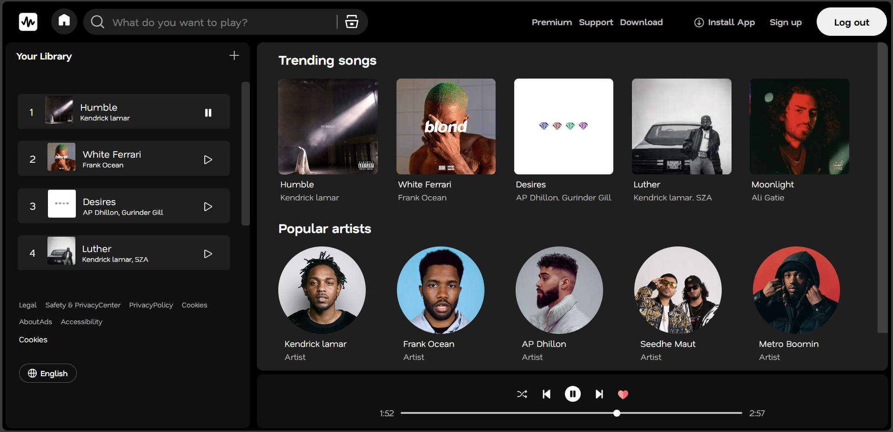
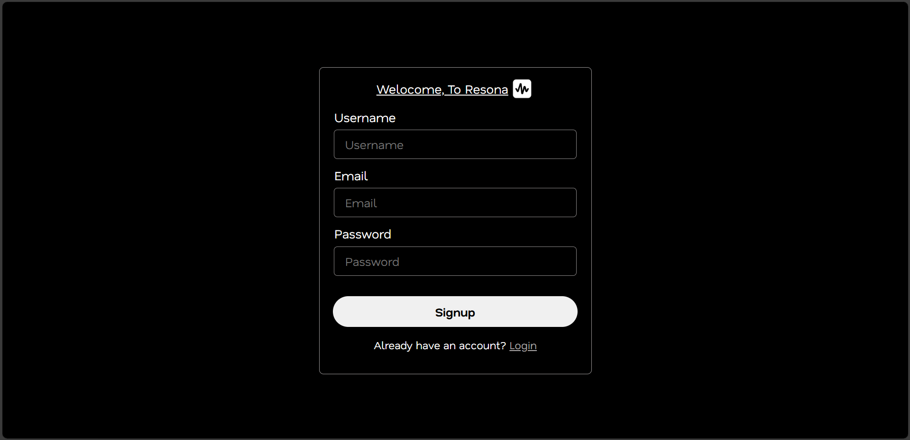

# Resona 🎵

 

Resona is a **full-stack web-based music application** where users can enjoy a curated collection of songs.  
It now includes **user authentication** (Signup, Login, and Logout) with **credentials securely stored in MongoDB**, powered by **Node.js, Express, and EJS** for server-side rendering.

---

## 🚀 Features

- 🎧 Play songs directly from the interface  
- 👤 **User Authentication**  
  - Signup, Login, and Logout functionality  
  - Credentials securely stored in MongoDB  
- ⚙️ **Backend Integration** using Node.js & Express  
- 🖥️ **Server-Side Rendering** with EJS templates   
- 🧭 Well-structured project setup combining frontend and backend

---

## 🔮 Future Enhancements

- Fully **responsive** and mobile-friendly layout  
- **Dynamic song loading** from an API  
- **Playlist creation & management**  
- **Enhanced user dashboard** for personalized experience  

---

## 💻 Getting Started

Follow these steps to clone and run the project locally:

```bash
git clone https://github.com/Pranjl7/Resona.git
cd Resona
npm install
npm start

```
## 🤝 Contributing

 Contributions, issues, and feature requests are welcome! Feel free to check the issues page.
 ## 📜 License

  Distributed under the MIT License.